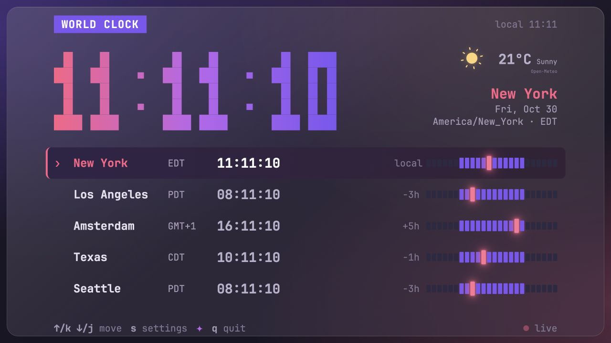
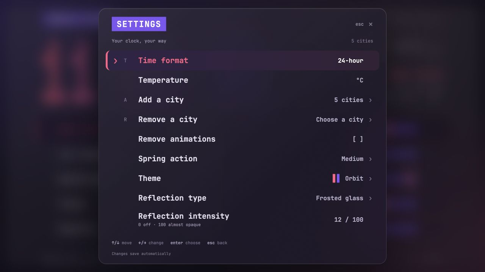

# World Clock

A world clock with an animated graphical interface for Ghostty and web browsers, plus a lightweight Go TUI. Compare cities, check the weather, and adjust the look from a keyboard-driven settings panel.

<a href="docs/images/clock.jpg">
  
</a>

*The graphical interface, captured in a browser. `make run` renders the same interface inside Ghostty without a browser toolbar. Times and weather in the screenshots are live readings from when they were captured.*

## Quick start

For the graphical terminal mode, you need Go 1.22 or later, Node.js 18 or later, npm, Make, `unzip`, and Ghostty. Run the commands directly in a Ghostty terminal.

1. Clone the repository:

   ```bash
   git clone https://github.com/amb1s1/worldtuiclock.git
   cd worldtuiclock
   ```

2. Start the clock:

   ```bash
   make run
   ```

The first run installs the pinned npm dependencies and Chrome Headless Shell, then builds and starts the Go server. Later runs reuse those downloads. Running `make` does the same thing as `make run`.

The launcher restarts an existing clock server only when it belongs to this checkout. If another application owns the port, it leaves that application running.

Press **Ctrl+Q** to exit the graphical terminal mode.

## Choose how to run it

| Mode | Command | What you get |
| --- | --- | --- |
| Graphical terminal | `make run` | The web interface rendered inside Ghostty through Chromium and the Kitty graphics protocol. |
| Web browser | `make web` | The same interface at [localhost:8787](http://127.0.0.1:8787/). Open the URL in your browser. |
| Go TUI | `make tui` | A character-based clock using Bubble Tea, Lip Gloss, Bubbles, and Harmonica. |

The graphical terminal mode has been used and checked on macOS with Ghostty. Automatic browser installation supports macOS and Linux x64; other terminal/platform combinations have not been verified.

Use another port when needed:

```bash
make run PORT=8788
# Or:
make web PORT=8788
```

You can also run the Go app directly, without Node.js or the terminal browser:

```bash
go run . --web                # Serve the graphical interface on port 8787
go run . --web --port=8788     # Use another port
go run .                     # Start the Go TUI
```

Direct `go run` commands do not restart an existing server. The web server binds to `127.0.0.1`.

## Controls

### Graphical clock

| Key | Action |
| --- | --- |
| `↑` / `k` | Select the previous city; wraps around. |
| `↓` / `j` | Select the next city; wraps around. |
| `s` | Open settings. |
| `q` | Quit from the main clock view and stop the local server. |
| `Ctrl+Q` / `Ctrl+C` | Exit the Ghostty launcher. For `make web`, press `Ctrl+C` in its terminal. |

You can also click a city or a footer control.

### Settings

<a href="docs/images/settings.jpg">
  
</a>

Use `↑` / `↓` or `j` / `k` to move, `←` / `→` to adjust a value, and `Enter` or `Space` to choose. `Esc` goes back or closes the panel; `s` also closes it. In city search fields, type to filter and use the arrow keys to navigate.

| Setting | Options |
| --- | --- |
| Time format | 12-hour with AM/PM or 24-hour. Shortcut: `t` while settings are open. |
| Temperature | Celsius or Fahrenheit. |
| Cities | Add from the searchable catalog with `a`, or remove with `r`. Keep between 1 and 24 cities. |
| Remove animations | Disable motion. The graphical interface also respects the system's reduced-motion preference. |
| Spring action | Small, Medium, or Super bouncing. |
| Theme | Orbit, Aurora, Ember, Glacier, Rose, or Moonlight. |
| Reflection type | Frosted glass, Clear glass, Liquid glass, Prism, or Matte. |
| Reflection intensity | 0–100: off at 0, almost opaque at 100. Use `←` / `→` for steps of 1 and `−` / `+` for steps of 10. `Enter` toggles the effect. |

Changes save automatically. The settings panel stays readable when reflection intensity obscures the clock.

### Go TUI

The Go TUI provides the five default cities, a spring-animated selector, a large clock, and day/night bars. It uses your terminal's font and needs at least **78 columns × 24 rows**.

Use `↑` / `k` and `↓` / `j` to select a city, `t` to switch between 12-hour and 24-hour time, and `q` or `Ctrl+C` to quit. The graphical settings panel and weather effects belong to the web/Ghostty interface.

## Cities, weather, and preferences

| Default city | IANA time zone |
| --- | --- |
| New York | `America/New_York` |
| Los Angeles | `America/Los_Angeles` |
| Amsterdam | `Europe/Amsterdam` |
| Texas | `America/Chicago` |
| Seattle | `America/Los_Angeles` |

Offsets are relative to your local time zone and account for daylight saving changes. The Go binary embeds `time/tzdata`.

The graphical interface gets weather from [Open-Meteo](https://open-meteo.com/), with animated icons and backgrounds for conditions such as sun, rain, clouds, snow, and thunderstorms. Texas uses Austin's weather and is labeled **Austin, TX**. Weather needs internet access; the clock continues working when weather is unavailable. Recent cached conditions may appear with an **Earlier** label during an outage.

Graphical preferences and the city list are stored in:

```text
~/.config/worldclock/settings.json
```

When `XDG_CONFIG_HOME` is an absolute path, the app uses `$XDG_CONFIG_HOME/worldclock/settings.json` instead. The Go TUI uses its built-in defaults rather than this settings file.

JetBrains Mono Regular and Bold are bundled for the graphical interface, so it does not need Google Fonts or a system font installation.

## Development

Run `make setup` to install the terminal browser dependencies without starting the clock. Initial dependency and tool downloads need internet access.

```bash
make test            # Go tests, go vet, JavaScript syntax checks, and Node tests
make lint            # Go lint and formatting checks
make fmt             # Format Go source files
go test -race ./...   # Check the Go tests for data races
```

Go code follows the [Uber Go Style Guide](https://github.com/uber-go/guide). The lint configuration checks `errcheck`, `govet`, `revive`, `staticcheck`, and `goimports`; design and ownership decisions still need review.

`make lint` and `make fmt` automatically download **golangci-lint v2.15.0** into `.tools/`. They use that pinned binary even if a different version is on your PATH. The download needs `curl` and the standard archive/checksum tools.

| Location | Purpose |
| --- | --- |
| `main.go` | Go TUI, keyboard input, styling, and spring animation. |
| `web.go`, `web_settings.go`, `web_weather.go` | Local HTTP server, embedded assets, preferences, and weather service. |
| `web/` | Graphical interface, styles, and bundled fonts. |
| `scripts/` | Launcher, Chromium/terminal rendering, input handling, and JavaScript tests. |
| `.artifacts/`, `.tools/`, `node_modules/` | Generated files and local dependencies; excluded from Git. |

## Troubleshooting

**Chrome Headless Shell is missing:** run `make setup`, then `make run`. Setup installs the browser revision required by the pinned Puppeteer version.

**The terminal is blank or displays browser controls:** exit with `Ctrl+Q` and run `make run` directly in Ghostty. This uses the clock's custom renderer. If the terminal still cannot display it, use `make web` to open the same interface in a browser.

**The page does not load from `web/index.html`:** start `make web` and open its HTTP URL. The interface needs the Go API server; opening the HTML through `file://` does not start it.

**The port is busy:** use `make run PORT=8788` or `make web PORT=8788`. Check terminal output for launcher errors and `.artifacts/server.log` for server logs when using Make.

**The clock is hard to see:** press `s`, select Reflection intensity, and lower it with `←` or `−`. Press `Enter` on that row to turn the effect off.

The bundled JetBrains Mono fonts include their [SIL Open Font License](web/fonts/OFL.txt).
